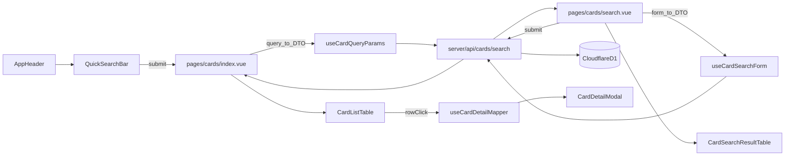

# Vuetify4向けコンポーネント分割プラン

## 対象と前提
- 対象: [`app/layouts/default.vue`](app/layouts/default.vue), [`app/pages/cards/index.vue`](app/pages/cards/index.vue), [`app/pages/cards/search.vue`](app/pages/cards/search.vue), [`app/components/CardDetailModal.vue`](app/components/CardDetailModal.vue)
- 方針: `pages` はデータ取得・ルーティング・状態調停（Container）、`components` は表示・入力（Presentational）
- 目的: モック段階の密結合を解消し、D1導入時に `pages`/`composables` だけ差し替えれば動く構造にする

## 現状分析（分割が必要な理由）
- [`app/layouts/default.vue`](app/layouts/default.vue): レイアウト + クイック検索状態 + ルーティングが同居
- [`app/pages/cards/index.vue`](app/pages/cards/index.vue): 条件チップ表示・テーブル描画・詳細モーダル変換ロジックが同居
- [`app/pages/cards/search.vue`](app/pages/cards/search.vue): 大規模フォーム（基本/ユニット/種族・タイプ/キーワード）と結果テーブルが同居
- [`app/components/CardDetailModal.vue`](app/components/CardDetailModal.vue): 表示専用に近いがカテゴリ別描画の重複が多い

## 提案ディレクトリ構造
- `app/components/atoms/`
  - `common/AppSectionHeader.vue`
  - `common/ZebraTableRow.vue`
  - `search/ElementChipToggle.vue`
- `app/components/molecules/`
  - `navigation/NavButtonGroup.vue`
  - `navigation/MobileNavList.vue`
  - `search/QuickSearchBar.vue`
  - `cards/ActiveConditionChips.vue`
  - `cards/CardMetaChips.vue`
  - `cards/CardEffectItem.vue`
- `app/components/organisms/`
  - `layout/AppHeader.vue`
  - `layout/AppFooter.vue`
  - `cards/CardListTable.vue`
  - `cards/CardSearchFormBasic.vue`
  - `cards/CardSearchFormUnit.vue`
  - `cards/CardSearchFormRaceType.vue`
  - `cards/CardSearchFormKeyword.vue`
  - `cards/CardSearchResultTable.vue`
  - `cards/CardEffectList.vue`
- `app/components/templates/`
  - `cards/CardSearchPanel.vue`
  - `cards/CardIndexPanel.vue`
- `app/composables/`
  - `useQuickSearch.ts`
  - `useCardSearchForm.ts`
  - `useCardQueryParams.ts`
  - `useCardDetailMapper.ts`
- `app/types/ui/`
  - `search.ts`
  - `cards.ts`

## コンポーネント一覧（Atomic Design + Props/Emits）
- `QuickSearchBar`（Molecule）
  - 役割: ヘッダー内のカードプール/検索種別/キーワード入力
  - props: `modelValue: QuickSearchState`, `cardPools`, `searchTypes`, `loading?`
  - emits: `update:modelValue`, `submit`
- `NavButtonGroup`（Molecule）
  - 役割: PC向けグローバルナビ
  - props: `items`, `activePath`
  - emits: `navigate`
- `MobileNavList`（Molecule）
  - 役割: Drawer向けナビ
  - props: `items`, `activePath`, `modelValue`
  - emits: `update:modelValue`, `navigate`
- `ActiveConditionChips`（Molecule）
  - 役割: 現在の検索条件表示
  - props: `conditions`
  - emits: `remove`, `clear`
- `CardListTable`（Organism）
  - 役割: カード一覧テーブル（クリックで詳細表示）
  - props: `headers`, `items`, `loading?`
  - emits: `rowClick`
- `CardSearchFormBasic`（Organism）
  - 役割: 基本情報セクション（名前/カテゴリ/レア/プール/セット）
  - props: `modelValue: BasicSearchForm`, `options`
  - emits: `update:modelValue`
- `CardSearchFormUnit`（Organism）
  - 役割: ユニット情報（レベル/攻防/移動タイプ/属性）
  - props: `modelValue: UnitSearchForm`, `moveTypeOptions`, `elementOptions`
  - emits: `update:modelValue`
- `CardSearchFormRaceType`（Organism）
  - 役割: 種族・タイプ入力
  - props: `modelValue: RaceTypeSearchForm`
  - emits: `update:modelValue`
- `CardSearchFormKeyword`（Organism）
  - 役割: キーワード入力
  - props: `modelValue: KeywordSearchForm`
  - emits: `update:modelValue`
- `CardSearchResultTable`（Organism）
  - 役割: 詳細検索結果表示
  - props: `headers`, `items`, `loading?`
  - emits: `rowClick`
- `CardMetaChips`（Molecule）
  - 役割: 詳細モーダルの属性/カテゴリ/Lv/移動種別チップ表示
  - props: `card`, `elementMap`, `categoryMap`
  - emits: なし
- `CardEffectItem`（Molecule）
  - 役割: 効果1件表示（タイトル/タイミング/条件/本文）
  - props: `effect`, `timingColorMap`
  - emits: なし
- `CardEffectList`（Organism）
  - 役割: カテゴリ別分岐を吸収して効果群を描画
  - props: `card`
  - emits: なし

## ページ責務（Container化）
- [`app/pages/cards/index.vue`](app/pages/cards/index.vue)
  - `route.query` 読み取り
  - `useCardQueryParams` で検索DTO化
  - API呼び出し（将来 `server/api/cards`）
  - `CardListTable` と `CardDetailModal` へのデータ供給
- [`app/pages/cards/search.vue`](app/pages/cards/search.vue)
  - `useCardSearchForm` でフォーム状態とDTO変換を管理
  - 検索実行トリガー
  - 結果を `CardSearchResultTable` に渡す
- [`app/layouts/default.vue`](app/layouts/default.vue)
  - `AppHeader`/`AppFooter` の組み立てのみ
  - クイック検索は `useQuickSearch` + `QuickSearchBar` で疎結合化

## D1連携しやすいデータフロー

## 実装優先順位
1. `cards/index` 周辺の分割（`ActiveConditionChips` / `CardListTable` / `useCardDetailMapper`）
   - 最も効果が高く、一覧→詳細導線の基盤になる
2. `cards/search` フォーム分割（4セクション + `useCardSearchForm`）
   - D1検索条件DTOの受け皿を先に固められる
3. `layouts/default` 分割（`AppHeader` + `QuickSearchBar` + ナビ系）
   - グローバルUIの責務を整理し、ページロジックから分離
4. `CardDetailModal` 内部分割（`CardMetaChips` / `CardEffectItem` / `CardEffectList`）
   - 重複描画を減らして保守性を上げる
5. 横断共通化（`AppSectionHeader` / `ZebraTableRow`）
   - `about/rules/restrictions` の重複UIを段階的に統一

## Vuetify4運用ルール（この分割で守る点）
- `v-model` を使う入力系は `modelValue` + `update:modelValue` に統一
- テーブル/フォームは `headers`・`items`・`options` を props で外出しし、表示コンポーネントを純粋化
- `v-card` + `v-sheet` のセクション見出しパターンを `AppSectionHeader` で共通化
- スタイルは `scoped` を維持しつつ、再利用する見た目は atoms 側に集約